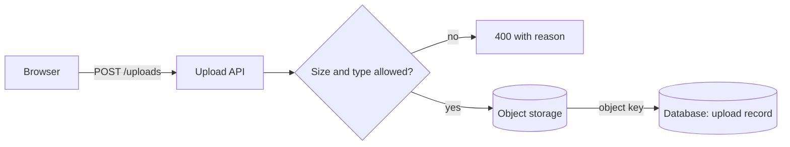
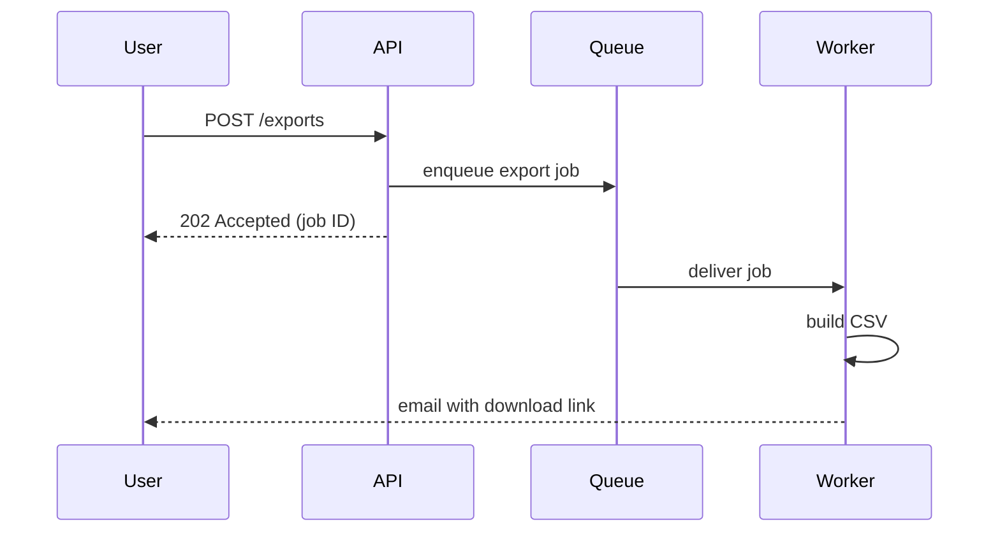
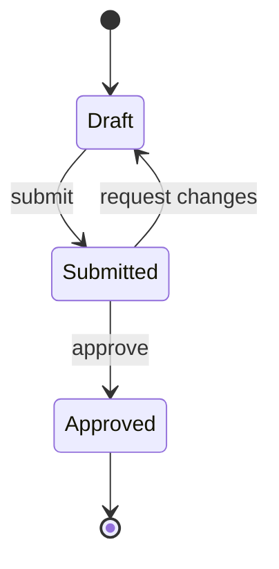
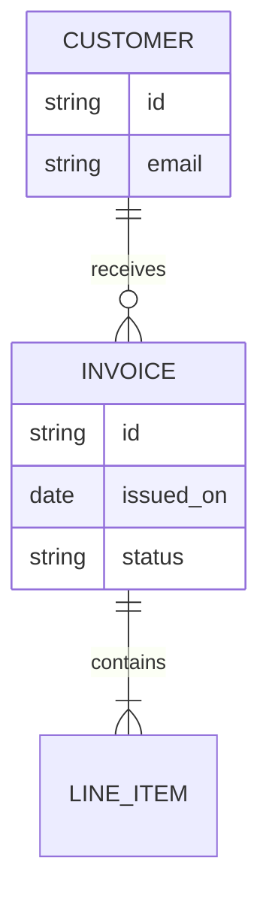
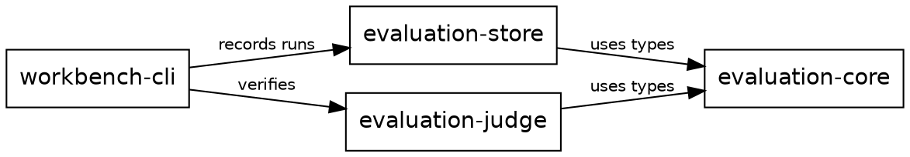

# Formats, Examples and Rendering

## Mermaid

Renders inside Markdown on GitHub and GitLab when fenced as `mermaid`.

**Flowchart** (a decision is a diamond node, not a self-loop)



**Sequence**



**State**



**Entity relationship**



Render locally to check layout (no online service needed for confidential diagrams):

```sh
npx -p @mermaid-js/mermaid-cli mmdc -i diagram.mmd -o diagram.svg
```

The CLI drives a headless browser; if it cannot download one, point it at an installed Chromium with a Puppeteer configuration file (`-p puppeteer.json`).

## Graphviz DOT

Strong automatic layout for larger graphs, such as generated dependency graphs.



```sh
dot -Tsvg deps.dot -o deps.svg
dot -Tpng -Gdpi=150 deps.dot -o deps.png
```

Generate DOT from real data where possible (package manifests, import graphs, database schemas) instead of writing it by hand.

## D2 and PlantUML

Use them when the project already does. Render with their own tools (`d2 input.d2 output.svg`, `plantuml -tsvg input.puml`) and commit the source files.

## Hand-written SVG

For branded website figures:

- set `viewBox` and let the figure scale; no fixed pixel width
- include `<title>` and `<desc>` as the first children, and `role="img"` with `aria-labelledby` pointing at them
- use `currentColor` or CSS custom properties so it follows light and dark themes
- keep text as real `<text>`, not paths, so it stays searchable and selectable

## Checking the render

- Open the SVG or PNG and look: crossings, overlapping labels, clipped text
- Check light and dark themes (GitHub renders Mermaid in the viewer's theme)
- Read it in the intended direction; if your eye jumps around, simplify or split it
