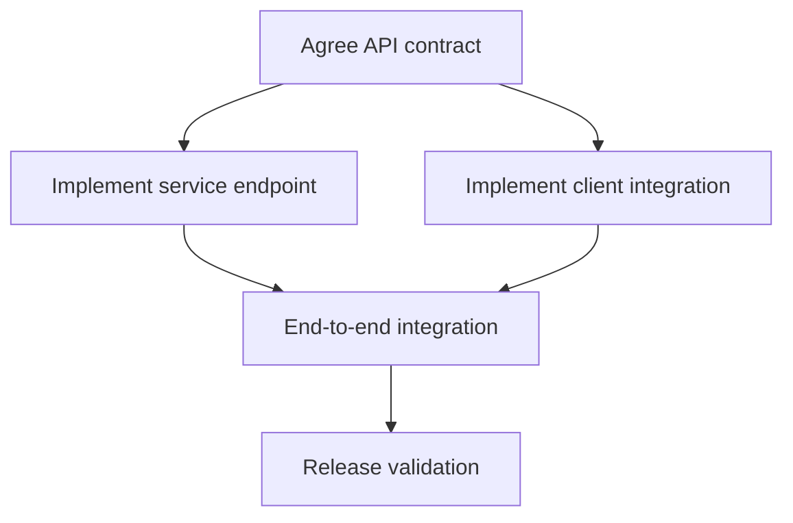

# Dependency and Execution Model

## 1. Purpose

A dependency model explains which work can proceed, what must happen first, where independent work converges, and what constraints limit concurrency.

A task list is not a dependency model. Ordering tasks in a document does not establish whether they are truly dependent.

## 2. Dependency classes

### Hard dependency
The dependent task cannot responsibly start until the prerequisite is complete.

Examples:
- A consumer cannot integrate against an interface that has not been agreed.
- A backfill cannot run before its schema is deployed.
- A release cannot proceed before required validation.

Represent this as a typed `hard` relationship record directed from prerequisite to dependent task. A `blocked_by` list may be derived for human display, but is not the canonical representation.

### Soft dependency
The task can begin using an explicit assumption, stub, mock, or provisional contract, but final completion depends on another result.

Record the assumption, why provisional work is safe, what must be revalidated, and an explicit `failure_conversion_rule` describing what happens if revalidation fails. The rule should identify the relationship update, dependent-task response, notification/escalation, and whether a hard prerequisite must be recorded after reconciliation. Do not silently change a relationship's type in place; preserve a revised or replacement relationship record with traceability.

### Integration dependency
Tasks can be implemented independently but must converge at a defined checkpoint.

Examples:
- Frontend and backend work against an agreed API.
- Multiple modules implement a shared protocol.
- Independently developed service changes require end-to-end validation.

Represent this as an `integration` relationship targeting a stable integration checkpoint. It may not block initial implementation, but it blocks the checkpoint's acceptance or release gate until convergence is verified. Do not model it as a hard start-order edge unless the work truly cannot start.

### Decision dependency
A task depends on a design, product, security, or compatibility decision. Link to the decision and its status. An unresolved decision that affects correctness is a blocker.

### External dependency
A task depends on an outside actor, system, approval, environment, or delivery. Identify the responsible party when known, expected output, and current status. Do not invent a delivery date.

### Resource conflict
Tasks compete for a shared mutable resource such as a schema, public interface, generated file, central configuration, test environment, or deployment window.

A resource conflict is not always a prerequisite relationship. It may require exclusive ownership, sequencing, isolation, or an explicit merge/integration strategy.

## 3. Graph representation

Represent tasks as nodes and dependencies as directed edges. For a hard dependency, draw the edge from prerequisite to dependent task.



Use stable task IDs in machine-oriented representations. Keep human-readable titles as labels.

## 4. Graph validation

Validate the graph before declaring execution order:

1. Every referenced task exists.
2. Every edge has a clear dependency meaning.
3. Hard dependencies contain no cycles.
4. No task depends on itself.
5. External dependencies are named rather than disguised as missing tasks.
6. Decision dependencies point to identifiable decisions.
7. Completed prerequisites have evidence.
8. Blocked tasks have a stated reason.
9. `enables` relationships agree with dependency edges.
10. Integration checkpoints identify all required contributing tasks.

A cycle indicates a modeling or design problem. Resolve it by:
- Splitting a task into contract/design and implementation phases.
- Introducing an agreed interface before parallel work.
- Replacing unnecessary mutual dependencies with a stable shared contract.
- Revising task boundaries.
- Escalating a genuine architecture deadlock.

Do not remove a real dependency merely to make the graph acyclic.

## 5. Parallel execution

Two tasks are parallel-safe only when concurrent work is compatible.

Evaluate:
- Shared files and directories.
- Public interfaces and schemas.
- Generated code or lockfiles.
- Database migrations.
- Global configuration.
- Shared test environments.
- Mutually dependent assumptions.
- Integration and merge complexity.
- Whether one task can invalidate another's work.

Different files do not automatically mean independent work. Two tasks changing different files may still conflict through a shared API or invariant.

For each parallel group, define:
- Entry conditions.
- Task owners.
- Shared interface or resource agreements.
- Expected outputs.
- Synchronization point.
- Integration owner.
- Failure and conflict handling.

Prefer independent tasks with stable boundaries. Where shared resources cannot be avoided, sequence the work or assign one owner.

## 6. Critical path and scheduling

The critical path is the longest chain of dependent work in a defined schedule model. It can identify tasks whose delay affects overall completion.

Do not calculate calendar dates from dependency structure alone. Duration estimates require evidence and explicit assumptions.

When reliable estimates exist, identify long dependency chains, tasks that unblock multiple branches, uncertain external dependencies, integration bottlenecks, and work that can be moved earlier to reduce risk.

If durations are unknown, report structural criticality rather than invented time estimates.

## 7. Integration checkpoints

Create checkpoints where independent work must be reconciled.

A useful checkpoint specifies:
- Contributing task IDs.
- Required deliverables.
- Interface or schema compatibility checks.
- Integration tests.
- Ownership.
- Acceptance criteria.
- What happens if contributions disagree.

Examples:
- API contract review before parallel implementation.
- Schema compatibility check before dependent service rollout.
- Cross-crate build and test after workspace changes.
- End-to-end validation after service and client changes.
- Release-readiness review after migration and application deployment.

## 8. Dependency changes during execution

When new evidence changes a dependency:
1. Identify the affected edge and reason.
2. Determine which tasks are already running.
3. Mark newly blocked work accurately.
4. Notify affected owners.
5. Reassess parallel groups and integration checkpoints.
6. Update the authoritative plan.
7. Preserve completed work where still valid.

Do not silently change a running task's prerequisites.

## 9. Common modeling mistakes

- Treating a preferred order as a hard dependency.
- Calling tasks parallel because they have different owners.
- Ignoring interface and schema coupling.
- Omitting integration work.
- Hiding external approvals in descriptions.
- Leaving cycles unresolved.
- Claiming a critical path without duration assumptions.
- Marking a prerequisite complete without evidence.
- Failing to update dependent tasks after a contract changes.


## 10. Canonical typed relationship records

Use stable, machine-readable relationship records. A task contract's `dependencies.relationships` is the source of truth; convenience views such as `blocked_by` and `enables` are derived. The task, decision, and integration-checkpoint records referenced in this relationship fragment are defined elsewhere in the same authoritative plan. The external dependency record is included here to demonstrate how an external endpoint resolves.

```yaml
external_dependencies:
  - id: "EXT-001"
    party_or_system: "Shared test environment"
    responsible_party: "Platform operations"
    expected_condition: "Test environment credentials are provisioned"
    status: "pending"
    evidence_ref: null
    timing_constraint: null

relationships:
  - id: "DEP-001"
    type: "hard"
    from: "TASK-010"
    to: "TASK-020"
    condition: "TASK-010 reaches lifecycle status done and publishes its output"
    status: "pending"
    evidence_ref: null

  - id: "DEP-002"
    type: "soft"
    from: "TASK-011"
    to: "TASK-020"
    assumption: "The provisional response shape remains compatible"
    safe_to_proceed_because: "Implementation uses a local adapter and fixture"
    revalidation_gate: "Before integration checkpoint INT-001"
    failure_conversion_rule: "If the assumed response shape is incompatible, mark this relationship failed, block TASK-020, notify its accountable owner, and create an explicit hard relationship after the plan is reconciled."
    status: "provisional"

  - id: "DEP-003"
    type: "integration"
    from: "TASK-020"
    to: "INT-001"
    condition: "Service and client contributions pass the shared contract tests"
    status: "pending"

  - id: "DEP-004"
    type: "decision"
    from: "DEC-002"
    to: "TASK-030"
    condition: "Decision DEC-002 is approved"
    status: "pending"

  - id: "DEP-005"
    type: "external"
    from: "EXT-001"
    to: "TASK-040"
    condition: "Test environment credentials are provisioned"
    status: "pending"
```

Relationship direction is always prerequisite/source → dependent/target. For integration relationships, the target may be an integration checkpoint rather than a task. Decision and external references must resolve to explicit records. Each type has type-specific fields; do not force soft assumptions or external-party details into a generic hard-edge shape.

### Relationship state semantics

Use a small explicit state vocabulary appropriate to each type:
- `pending`: condition not yet satisfied.
- `satisfied`: condition has been met and evidence is available.
- `provisional`: soft dependency may be used under its recorded assumption.
- `failed`: condition is not met or the assumption was invalidated.
- `waived`: an authorized decision explicitly removes the requirement.
- `unknown`: state cannot currently be established.

A `waived` relationship requires an authority and evidence reference. Never infer waiver from inactivity or omission. A soft relationship remains `provisional` while the dependent work relies on its assumption; after revalidation, set it to `satisfied` with evidence if the assumption holds, or `failed` and apply its `failure_conversion_rule` if the assumption is invalidated.

## 11. Resource conflict records

Resource conflicts are coordination constraints, not prerequisite edges:

```yaml
resource_conflicts:
  - id: "RES-001"
    resource: "src/api/schema.rs"
    resource_type: "shared_file"
    affected_tasks: ["TASK-020", "TASK-021"]
    strategy: "single_owner"
    accountable_owner: "agent-api"
    synchronization_point: "INT-001"
```

Supported strategies may include `single_owner`, `sequence`, `isolated_worktrees`, `contract_first`, or `explicit_merge`. Choose based on the actual resource and workflow. Record exclusive ownership or synchronization where concurrent writes are unsafe.

## 12. Stable integration checkpoints

Every integration checkpoint receives a stable identity and revision:

```yaml
integration_checkpoints:
  - checkpoint_id: "INT-001"
    revision: "1.0.0"
    title: "API and client contract integration"
    contributors:
      - task_id: "TASK-020"
        required_deliverable: "Service endpoint and contract tests"
      - task_id: "TASK-021"
        required_deliverable: "Client integration"
    acceptance_criteria:
      - id: "IC-001"
        condition: "Client and service agree on request and response semantics"
      - id: "IC-002"
        condition: "Contract and end-to-end tests pass"
    verification:
      status: "not_started"
      required_checks: ["Contract tests", "End-to-end integration tests"]
      completion_evidence: []
    acceptance:
      required: true
      status: "pending"
      authority: "integration-lead"
      scope: "INT-001 API and client integration"
      criteria_refs: ["IC-001", "IC-002"]
      evidence_ref: null
      decided_by: null
      decided_at: null
      decision_ref: null
      conditions: []
      rationale: null
    accountable_owner: "integration-lead"
    status: "pending"
    failure_handling:
      - "Stop release progression"
      - "Record incompatibility and reconcile affected contracts"
```

Checkpoint identity remains stable while its purpose remains stable. Revision it when contributor scope or acceptance meaning changes. Assign one accountable owner. Integration checkpoints are explicit work/gates, not informal milestones hidden in prose.

Use the following checkpoint `status` values:
- `pending`: required contributions or checkpoint work have not begun or are not yet assembled.
- `in_progress`: contributors are producing or integrating the required deliverables.
- `blocked`: a required contribution or prerequisite prevents meaningful checkpoint progress.
- `in_review`: contributions are assembled and checkpoint verification/acceptance is awaiting evaluation.
- `accepted`: checkpoint criteria have been verified and the authorized checkpoint authority accepted the result; record evidence and authority.
- `failed`: checkpoint verification or acceptance failed; record the failure and corrective/reconciliation path.
- `waived`: an authorized authority waived the checkpoint gate; record scope and durable evidence.
- `superseded`: a newer checkpoint revision or replacement makes this record no longer authoritative.

Do not mark a checkpoint `accepted` merely because all contributors report completion. Acceptance requires the checkpoint's own criteria, verification evidence, and authorized acceptance. A `waived` checkpoint requires explicit authority and evidence.

The normal progression is `pending` → `in_progress` → `in_review` → `accepted`. A checkpoint may move to `blocked` when a required contribution is unavailable, or to `failed` when verification/acceptance fails. After the blocker is resolved or corrective work is complete, it may return to `in_progress` or `in_review` as appropriate. `waived` and `superseded` close the current checkpoint record; preserve the prior revision and evidence.

Keep checkpoint lifecycle and its acceptance record aligned:
- `status: accepted` requires `verification.status: passed` and `acceptance.status: accepted`.
- `status: waived` requires `acceptance.status: waived` with the authorized waiver evidence.
- `status: failed` requires a failed verification or rejected acceptance, with rationale and corrective/reconciliation handling.
- `status: in_review` is appropriate while required verification or formal acceptance is pending.
- The checkpoint `status` summarizes checkpoint progression; the nested `verification` and `acceptance` records remain the evidence and authority-bearing sources of truth.

## 13. Graph and scheduling validation rules

- Validate references for every relationship type, including task, decision, external prerequisite, and checkpoint references.
- Detect cycles in hard prerequisite relationships. Do not create false cycles by treating integration convergence or resource conflicts as ordinary hard edges.
- Validate soft dependencies for an explicit assumption, safe-to-proceed rationale, revalidation gate, and `failure_conversion_rule` that states the relationship, dependent-task, and escalation response if revalidation fails.
- Validate decision dependencies against the decision's current approval state and provenance.
- Validate external dependencies for named condition, `status`, expected output, and owner when known.
- Validate every checkpoint's contributors, deliverables, acceptance criteria, accountable owner, canonical `status`, verification/acceptance authority, and failure handling. Check status transitions against the checkpoint status definitions.
- Validate resource conflicts for affected tasks and an explicit coordination strategy.
- Validate derived `blocked_by` and `enables` views against the typed relationship records.
